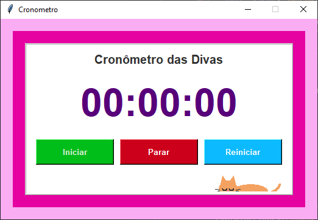

# Cronômetro das Divas #
Aplicação desktop desenvolvida em Python com Tkinter para contagem de tempo com identidade visual marcante, estrutura modular e toque criativo. 
O projeto une organização de estado e interface gráfica personalizada em um formato simples e direto de usar.

## Principais recursos ##

- Controles de tempo: botões para Iniciar, Parar e Reiniciar, com formatação no padrão HH:MM:SS e atualização periódica via after;
- Layout e identidade visual: janela em fundo rosa claro, container pink, card branco centralizado e display em destaque roxo;
- Ilustração customizada: gatinho laranja deitado desenhado com Canvas no canto inferior direito do card, sem dependência de arquivos externos

